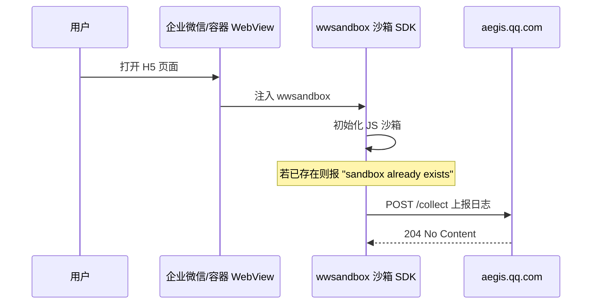

## 会话 5527af1d-0f46-4f2c-ba46-e321ddfcd4b1
- 时间：2026-05-11T08:17:50　来源：cursor　模型：cursor-agent
- 代码基线：751b0ee
- 用户轮次：2　工具调用：31
- 涉及文件：d:\repository\i淮安H5\src\pages_benefit\assetsPublicity\index.vue、d:\repository\i淮安H5\src\pages_benefit\assetsPublicity\parkingLeaseSituation.vue、d:\repository\i淮安H5\src、d:\repository\i淮安H5\src\api\benefit.js、d:\repository\i淮安H5\src\pages.json、d:\repository\i淮安H5\src\api\request.js、d:\repository\i淮安H5\src\api\index.js、d:\repository\i淮安H5\.env.development

### 用户诉求 1
[Image]

The following images were provdied by the user and saved to the workspace for future use:
1. C:\Users\Administrator\.cursor\projects\d-repository-i-H5/assets/c__Users_Administrator_AppData_Roaming_Cursor_User_workspaceStorage_e778b5f795fab236c6f507056669d080_images_____-07a98d57-19da-406f-bd08-96a9042a1b20.png

These images can be copied for use in other locations.

@src/pages_benefit/assetsPublicity/index.vue 从这里跳转，新增租赁情况菜单，参考设计图实现，/v2.0/benefit/pubRevenueContract/page?pageNum=1&pageSize=10&bizState=2&projectId=xxxxxxxxx&contractTypes=3参考接口

### 用户诉求 2
车位号：spaceNumber
车牌号：licensePlateNumber
有效期开始：leaseStartDate
有效期截止：leaseEndDate

### 最终结论
已按你给的字段改好了 `parkingLeaseSituation.vue`，当前逻辑如下：

- **车位号**：`spaceNumber`，空则显示 `-`
- **车牌号**：仅用 `licensePlateNumber`，仍按原规则脱敏（已含 `*` 则原样展示）
- **有效期**：`leaseStartDate`、`leaseEndDate`，经 `dayjs` 格式化为 `YYYY-MM-DD HH:mm:ss`，中间用 ` ~ ` 连接

卡片三行依次为：「车位号：…」「车牌号：…」「有效期：…」。

---

## 会话 ad9bc1a2-a5a1-4175-a830-85119f00b039
- 时间：2026-05-11T08:03:50　来源：cursor　模型：cursor-agent
- 代码基线：751b0ee
- 用户轮次：2　工具调用：29
- 涉及文件：d:\repository\i淮安H5\src\pages_benefit\assetsPublicity\index.vue、d:\repository\i淮安H5、d:\repository\i淮安H5\src\pages.json、d:\repository\i淮安H5\src\api\benefit.js、d:\repository\i淮安H5\src\pages_benefit、d:\repository\i淮安H5\src\pages_benefit\assetsPublicity\parkingLeaseSituation.vue、d:\repository\i淮安H5\src\pages\index\home.vue、d:\repository\i淮安H5\src

### 用户诉求 1
[Image]

The following images were provdied by the user and saved to the workspace for future use:
1. C:\Users\Administrator\.cursor\projects\d-repository-i-H5/assets/c__Users_Administrator_AppData_Roaming_Cursor_User_workspaceStorage_e778b5f795fab236c6f507056669d080_images_____-92af5a28-c551-4c61-9ffb-e4b15df0f48d.png

These images can be copied for use in other locations.

@src/pages_benefit/assetsPublicity/index.vue 参照设计图增加租赁情况按钮

### 用户诉求 2
@src/pages/index/home.vue 房屋不要根据参数里面的complexId和houseId判断了，直接根据接口数据来判断

### 最终结论
已按你的要求改好了，变更如下。

### 1. `onShow` 里拉房屋列表

- **之前**：只有 `userStore.project`（complexId）和 `userStore.houseId` 都存在时才请求，且用 `houseId` 把接口结果筛成一条再 `setHouse`。
- **现在**：只要已登录就请求 `getMyHouses`，只带 `identityType: '1'`、`identityStatus: '2'`（与报修页等一致，**不再传 `complexId`**），把接口返回的 **`rows` 原样** 交给 `userStore.setHouse`。

### 2. `ensureHouseSelected`

- **之前**：只看 `userStore.houseId`。
- **现在**：与首页展示一致，用计算属性 **`hasHouse`**（即 `houseList` 是否有数据）判断；接口已拉到房屋即可进公告、表决、快捷菜单等。

若后续子页面仍强依赖 `userStore.project` / `houseId`，需要在选房或进页时再同步一次 store；本次仅按「房屋以接口为准、不依赖参数里的 complexId/houseId」改了首页逻辑。

---

## 会话 15f86f8b-8c62-4896-a2df-6d0588e27eac
- 时间：2026-05-11T08:51:54　来源：cursor　模型：cursor-agent
- 代码基线：751b0ee
- 用户轮次：2　工具调用：22
- 涉及文件：d:\repository\i淮安H5\src\pages_benefit\elevatorPubEngCons\index.vue、d:\repository\i淮安H5\src\pages_benefit\assetsPublicity\index.vue、d:\repository\i淮安H5\src\utils、d:\repository\i淮安H5\src\pages.json、d:\repository\i淮安H5\src\utils\index.js、d:\repository\i淮安H5\src、d:\repository\i淮安H5\src\pages_benefit\elevatorPubEngCons\detail.vue、d:\repository\i淮安H5\src\api\benefit.js

### 用户诉求 1
[Image]

The following images were provdied by the user and saved to the workspace for future use:
1. C:\Users\Administrator\.cursor\projects\d-repository-i-H5/assets/c__Users_Administrator_AppData_Roaming_Cursor_User_workspaceStorage_e778b5f795fab236c6f507056669d080_images______-2b6dd3ef-d7e6-43d3-9707-d85c09a06f23.png

These images can be copied for use in other locations.

@src/pages_benefit/elevatorPubEngCons/index.vue 参考设计图修改

### 用户诉求 2
mock一些数据，我看看样式

### 最终结论
已加上本地 mock，用法如下。

### 说明
- 文件顶部有常量 **`USE_MOCK_FOR_STYLE`**，当前为 **`true`**：不请求接口，用与设计稿接近的数据（龙城雅居、年度汇总 450/50 笔、金额与 4 条月度列表）。
- 切换年份时，列表标题里的年份会跟着变。
- 点击 **「明细」** 会 toast：`当前为样式预览，无真实明细`，避免跳进详情却调不通接口。
- 顶部蓝卡文案在 mock 下固定为 **龙城雅居** / **龙城雅居-18-8**；关掉 mock 后仍用 `userStore` 的真实项目信息。

### 接回真实数据
把 **`USE_MOCK_FOR_STYLE` 改成 `false`** 即可恢复走 `elevMnt` / `pubEnergyCons` 接口。

---

## 会话 1e77ea97-275e-42aa-a27d-5b8012829041
- 时间：2026-08-06T09:15:14　来源：cursor　模型：cursor-agent
- 代码基线：6bc5250
- 用户轮次：1　工具调用：23
- 涉及文件：d:\repository\i淮安H5、d:\repository\i淮安H5\src\pages\index\newHome.vue、d:\repository\i淮安H5\src\pages\index\components\GridOverlayMenu.vue、d:\repository\i淮安H5\src、d:\repository\i淮安H5\src\pages\index\components\ZsImageOverlay.vue、d:\repository\i淮安H5\src\pages.json、d:\repository\i淮安H5\src\utils、d:\repository\i淮安H5\src\pages\index\components\GridMenu.vue

### 用户诉求 1
[Image]
[Image]

The following images were provided by the user and saved to the workspace for future use:
1. C:\Users\Administrator\.cursor\projects\d-repository-i-H5/assets/c__Users_Administrator_AppData_Roaming_Cursor_User_workspaceStorage_e778b5f795fab236c6f507056669d080_images____2_2x-9eb57175-c8ea-4cf8-8d5c-40f5595db169.png
2. C:\Users\Administrator\.cursor\projects\d-repository-i-H5/assets/c__Users_Administrator_AppData_Roaming_Cursor_User_workspaceStorage_e778b5f795fab236c6f507056669d080_images___-4eec32cf-66ef-4356-83bf-7d69c4729816.png

These images can be copied for use in other locations.

在C端首页增加文旅区入口，入口地址为：https://www.huaiangaoxin.top/web1/#/

### 最终结论
已在 C 端首页增加文旅区入口，修改如下：

### 修改内容

**文件：** `src/pages/index/newHome.vue`

1. **新增横幅入口**：在「有事要办」和「信息服务」之间加入可点击的文旅区横幅，位置与设计稿一致。
2. **跳转逻辑**：
   - H5：新窗口打开 `https://www.huaiangaoxin.top/web1/#/`
   - 小程序 / APP：通过项目已有的 `webView` 页面内嵌打开
3. **静态资源**：新增 `src/static/images/home/cultural-tourism-banner.png`（淮安生态文旅区横幅图）

### 效果说明

首页从上到下依次为：顶部轮播 → 有事要办 → **文旅区横幅（可点击）** → 信息服务。

点击横幅即可进入文旅区阳光智慧物业共管平台。

> **注意**：若在微信小程序中使用，需将 `huaiangaoxin.top` 配置到小程序业务域名白名单，否则 web-view 可能无法加载。

---

## 会话 8ea610f8-3799-4753-8f73-41ed8bb06b46
- 时间：2026-07-31T10:04:56　来源：cursor　模型：cursor-agent
- 代码基线：7d2c722
- 用户轮次：1　工具调用：22
- 涉及文件：d:\repository\i淮安H5\src\pages_owner\repair\submit.vue、d:\repository\i淮安H5\src\components\ZsUploader\ZsUploader.vue、d:\repository\i淮安H5\src\api\file.js、d:\repository\i淮安H5\src\api\index.js、d:\repository\i淮安H5\src\components\ImageUploader\ImageUploader.vue、d:\repository\i淮安H5\src\pages\index\my.vue

### 用户诉求 1
[Image]

The following images were provided by the user and saved to the workspace for future use:
1. C:\Users\Administrator\.cursor\projects\d-repository-i-H5/assets/c__Users_Administrator_AppData_Roaming_Cursor_User_workspaceStorage_e778b5f795fab236c6f507056669d080_images_image-8327a48e-9c0a-4488-88f0-8d9693d368a4.png

These images can be copied for use in other locations.

我要报修，一次性上传图片多张，只显示一张。选了多张，只传了1张

### 最终结论
**问题原因**

在 `ZsUploader` 组件里，选择图片后的 `handleUpload` 只处理了第一张：

```103:116:src/components/ZsUploader/ZsUploader.vue
// 修复前：只上传 tempFiles[0]
```

一次性多选时，`uni-file-picker` 会把所有图片放在 `tempFiles` 数组里，但原逻辑只上传 `tempFiles[0]`，所以界面上只会显示 1 张（计数也是 1/9）。

**修复内容**

已改为遍历本次选中的全部图片并并行上传：

1. 按 `limit` 限制可上传数量（最多 9 张）
2. 逐个校验单张大小（默认不超过 2MB）
3. 用 `Promise.all` 并行上传所有合法图片
4. 全部成功后一次性更新列表和 `form.photo`

请重新编译/刷新 H5 后，在「我要报修」里一次性选多张图片验证，应能正常显示多张并正确计数（如 3/9）。

---

## 会话 598cd80d-9c2c-4ea8-987a-c34e4ba7c0fd
- 时间：2026-08-14T01:59:39　来源：cursor　模型：cursor-agent
- 代码基线：b6d9a5e
- 用户轮次：1　工具调用：21
- 涉及文件：d:\repository\i淮安H5、d:\repository\i淮安H5\package.json、d:\repository\i淮安H5\index.html、d:\repository\i淮安H5\vite.config.ts、d:\repository\i淮安H5\src、d:\repository\i淮安H5\src\main.ts、d:\repository\i淮安H5\.env.test、d:\repository\i淮安H5\src\utils\dsbridge.ts

### 用户诉求 1
为什么线上会请求这个接口？POST https://aegis.qq.com/collect?id=bRLDot6R4Kymzz0jPO&from=http://unlimited.c.h5.admin.mobile.v2.wuguan.all.huaian.test.zhishusz.com&sessionId=nj6lokag4bokjkox0ljg3&version=wwsandbox%40260731-152018-252 204

Request Data

msg[0]=sandbox%20already%20exists&level[0]=4&count=1

Request Headers

Content-type: application/x-www-form-urlencoded

### 最终结论
这个请求**不是你的 H5 业务代码主动发起的**，而是**运行环境（容器）里内置的 SDK 自动上报**的监控日志。

## 结论

`POST https://aegis.qq.com/collect` 是**腾讯云 Aegis（前端 RUM 监控）**的默认上报地址。结合请求参数可以判断：这是**企业微信 / 容器侧 `wwsandbox` 沙箱 SDK**在往腾讯监控平台上报一条内部日志，**与你们项目的接口、业务逻辑无关**。

我在当前仓库里搜索过，**没有**接入 Aegis：

- `package.json` 里没有 `aegis-web-sdk`
- 源码里没有 `aegis.qq.com`、`Aegis`、`wwsandbox` 等引用
- `index.html` / `vite.config.ts` 也没有注入相关脚本

## 请求参数解读

| 参数 | 含义 |
|------|------|
| `id=bRLDot6R4Kymzz0jPO` | Aegis 项目 ID，属于**容器/SDK 方**（腾讯侧），不是你们项目配置的 |
| `from=http://unlimited.c.h5.admin.mobile.v2.wuguan.all.huaian.test.zhishusz.com` | 当前 H5 页面所在域名（注意是 **test** 测试环境） |
| `version=wwsandbox@260731-152018-252` | **`wwsandbox`** = 企业微信（WeWork）沙箱模块版本号 |
| `msg[0]=sandbox already exists` | 沙箱环境**重复初始化**时的提示 |
| `level[0]=4` | Aegis 日志级别（自定义/信息类日志） |
| 响应 `204` | **正常**，表示上报成功，无返回体 |

## 为什么会发这个请求？

典型链路如下：



也就是说：

1. H5 在**企业微信内置浏览器**或带 `wwsandbox` 的 WebView 里打开时，容器会自动注入沙箱 SDK。
2. 该 SDK 内置了 Aegis，会把运行日志自动上报到 `aegis.qq.com`。
3. `sandbox already exists` 表示**沙箱被初始化了不止一次**，常见场景：
   - SPA 路由切换（你们是 Vue/uni-app H5）
   - 页面刷新 / 热更新
   - 脚本被重复加载
   - 父页面和 iframe 各初始化一次

## 和你们项目的关系

你们项目 H5 侧主要做的是：

- 通过 `dsbridge` 调 i淮安 App 的 `BusinessApi.getUserInfo`（见 `src/main.ts`）
- 测试环境开了 `eruda` 调试工具

这些都**不会**触发 `aegis.qq.com/collect`。这个请求来自**容器层**，不是你们的 `axios` / API 封装。

## 需要处理吗？

| 情况 | 建议 |
|------|------|
| 只是网络面板里看到，功能正常 | **可忽略**，属于容器/SDK 内部监控 |
| 担心隐私/合规 | 这是腾讯侧监控，上报的是 SDK 运行日志，不是你们业务接口数据 |
| 想减少这类请求 | 需要在**容器/SDK 侧**关闭或配置 Aegis（你们 H5 代码里改不了） |
| 担心 `sandbox already exists` 影响功能 | 一般是 SDK 内部 warning，通常**不影响业务**；若真有异常，再查是否重复引入企业微信 JS-S …[truncated]

---

## 会话 0827ee09-4d39-4174-b6b1-6333e223e06e
- 时间：2026-05-12T05:39:42　来源：cursor　模型：cursor-agent
- 代码基线：edb310d
- 用户轮次：2　工具调用：16
- 涉及文件：d:\repository\i淮安H5\src\pages_owner\house\automaticAdd.vue、d:\repository\i淮安H5\src\pages_owner、d:\repository\i淮安H5\src\pages_owner\repair\submit.vue、d:\repository\i淮安H5\src、d:\repository\i淮安H5\src\components、d:\repository\i淮安H5\src\components\ZsButton\ZsButton.vue、d:\repository\i淮安H5\src\pages_owner\decision\components\StepSign.vue

### 用户诉求 1
@src/pages_owner/house/automaticAdd.vue 调用接口时加loading

### 用户诉求 2
确认添加的地方是否调用接口？如果是，添加全屏loading，防止重复提交

### 最终结论
## 是否调接口？

**会，但只在一种情况下调。**  
在已选房屋且 `currentSelect.houseId` 存在时，会请求 `addOwnerDirectly`（确认添加业主）。  
若没有 `houseId`，只会 `uni.navigateTo` 到 `/pages_owner/house/owner/addNoCode`，**不调**添加接口。

## 已做的改动

1. **`uni.showLoading` 增加 `mask: true`**：全屏遮罩，拦截触摸，和项目里 `ViewOptionsList.vue` 的用法一致。  
2. **`submitting` 状态**：请求前设为 `true`，在 `finally` 里恢复为 `false`，避免逻辑上重复发起。  
3. **按钮 `:disabled="submitting"`**：提交过程中禁用「确认添加」，防止连点。  
4. **方法开头 `if (this.submitting) return`**：与遮罩、禁用一起，多一层防护。

这样「确认添加」在真正走 `addOwnerDirectly` 时，既有全屏 loading，又不易重复提交。

---

## 会话 e5c5eb19-6eed-4d0f-a188-d9777acdf189
- 时间：2026-07-30T01:59:36　来源：cursor　模型：cursor-agent
- 代码基线：cdd8f19
- 用户轮次：1　工具调用：16
- 涉及文件：d:\repository\i淮安H5、d:\repository\i淮安H5\src\pages_owner\repair\submit.vue、d:\repository\i淮安H5\src\components\ZsUploader\ZsUploader.vue

### 用户诉求 1
[Image]

The following images were provided by the user and saved to the workspace for future use:
1. C:\Users\Administrator\.cursor\projects\d-repository-i-H5/assets/c__Users_Administrator_AppData_Roaming_Cursor_User_workspaceStorage_e778b5f795fab236c6f507056669d080_images_image-fa2d3bda-4c94-4a1a-9910-04ae1fb645ca.png

These images can be copied for use in other locations.

1、我要报修中的图片要求设置为必传，

2、增加图片上传进度：如1/9,表示最大上传9张，已上传1张

### 最终结论
已完成修改，变更如下：

### 1. 图片必传（仅「我要报修」）
- 在 `isBaoxiu`（报修类型）时，为 `photo` 字段增加必填校验
- 未上传图片时提交会提示「请上传图片」
- 标题旁增加红色 `*` 标识必填

### 2. 上传进度显示
- 在「请上传图片」标题右侧显示 `已上传数/9`（如 `0/9`、`1/9`）
- 根据 `form.photo` 中逗号分隔的图片 URL 实时计算数量

修改文件：`src/pages_owner/repair/submit.vue`

```18:26:src/pages_owner/repair/submit.vue
          <uni-forms-item name="photo" label-width="0">
            <div class="flex items-center justify-between">
              <div class="font-(color-333 weight-600 32) leading-44">
                请上传图片
                <text v-if="isBaoxiu" class="required-mark">*</text>
              </div>
              <div class="font-(color-999 weight-400 28) leading-40">{{ photoCount }}/9</div>
            </div>
          </uni-forms-item>
```

说明：「我有话说」等其他报事类型仍不强制上传图片，但会显示上传进度。如需所有类型都必传图片，可以告诉我再调整。

---

