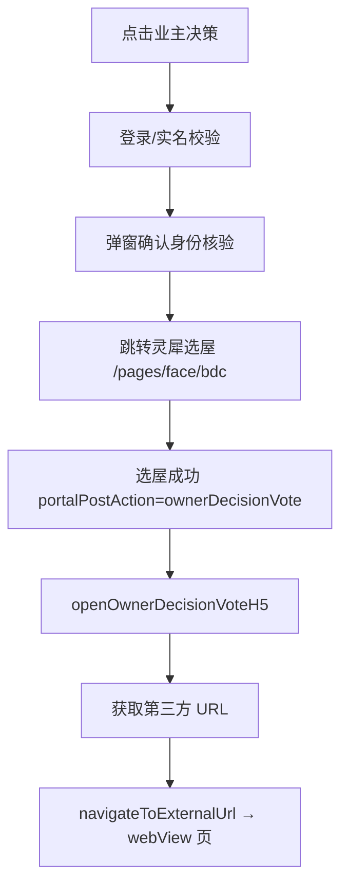

## 会话 2a5dc010-d890-4a11-a627-83db6d26d2b6
- 时间：2026-07-13T02:50:22　来源：cursor　模型：cursor-agent
- 代码基线：afd47ed
- 用户轮次：5　工具调用：80
- 涉及文件：d:\repository\无锡市区小程序嵌入H5\zhi2-mobile-admin-h5-c-unlimited\src\pages\index\home.vue、d:\repository\无锡市区小程序嵌入H5\zhi2-mobile-admin-h5-c-unlimited\src\pages\index\newHome.vue、d:\repository\无锡市区小程序嵌入H5\zhi2-mobile-admin-h5-c-unlimited\src\pages\webview\home.vue、d:\repository\无锡市区小程序嵌入H5\zhi2-mobile-admin-h5-c-unlimited\src\utils\sfbFaceAuth.js、d:\repository\无锡市区小程序嵌入H5\zhi2-mobile-admin-h5-c-unlimited\src\pages\face\face.vue、d:\repository\无锡市区小程序嵌入H5\zhi2-mobile-admin-h5-c-unlimited、d:\repository\无锡市区小程序嵌入H5\zhi2-mobile-admin-h5-c-unlimited\src\utils\h5Context.js、C:\Users\Administrator\.cursor\projects\d-repository-H5\terminals\178711.txt

### 用户诉求 1
移除首页苏服办人脸识别测试功能相关的代码

### 用户诉求 2
在现有调用苏服办人脸识别的地方加一些失败条件的日志，目前苏服办APP里面可以人脸识别，但是在支付宝小程序里面不可以

### 用户诉求 3
Briefly inform the user about the task result and perform any follow-up actions (if needed). If there's no follow-ups needed, don't explicitly say that.

### 用户诉求 4
现在在支付宝里面彻底打不开了，之前清理缓存还是可以打开的

### 用户诉求 5
苏服办里面也失效了，提示用户扫脸核验令牌已失效

### 最终结论
问题出在近期加的 **`forceFresh` + `getTicket` 逻辑**。

苏服办 SDK 人脸识别要求：
- **arg1**：苏服办用户 token（URL 传入的那个）
- **arg2**：`'1'`（用户 token 类型）

之前代码默认会调 `getTicket` 换成票据，并把 `tokenType` 改成 `'0'`，SDK 就会报 **「用户扫脸核验令牌已失效」**。

### 已修复

1. **`face.vue`**：去掉 `forceFresh: true`，恢复直接传用户 token  
2. **`sfbFaceAuth.js`**：默认不再走 `getTicket`，只有显式传 `forceFresh: true` 时才尝试；同时去掉每次调起前清除 `faceAppid` 缓存的操作

请重新打包部署后再在苏服办里试一次。若仍提示令牌失效，先**完全退出苏服办重新从入口进入**（确保 URL 带上新的 token），再把控制台里 `[苏服办人脸识别]` 的日志发我。

---

## 会话 2b377a1c-983a-4b59-8b7b-4fecc4297896
- 时间：2026-09-10T01:49:57　来源：cursor　模型：cursor-agent
- 代码基线：1cce226
- 用户轮次：2　工具调用：86
- 涉及文件：d:\repository\无锡市区小程序嵌入H5、d:\repository\无锡市区小程序嵌入H5\zhi2-mobile-admin-h5-c-unlimited、d:\repository\无锡市区小程序嵌入H5\zhi2-mobile-admin-h5-c-unlimited\src\pages_owner\decision\index.vue、d:\repository\无锡市区小程序嵌入H5\zhi2-mobile-admin-h5-c-unlimited\src\pages_owner\decision\components\DecisionList.vue、d:\repository\无锡市区小程序嵌入H5\zhi2-mobile-admin-h5-c-unlimited\src\pages_owner\decision、d:\repository\无锡市区小程序嵌入H5\zhi2-mobile-admin-h5-c-unlimited\src、d:\repository\无锡市区小程序嵌入H5\zhi2-mobile-admin-h5-c-unlimited\src\pages_owner\decision\detail.vue、d:\repository\无锡市区小程序嵌入H5\zhi2-mobile-admin-h5-c-unlimited\src\pages\index\home.vue

### 用户诉求 1
进入业主决策页面的方式有多种吗？还是统一的写法?

### 用户诉求 2
我指的是首页跳转第三方链接的

### 最终结论
你说得对，这里要区分 **门户首页**（`pages/webview/home`，苏服办嵌入 H5 的实际首页）和旧版首页（`pages/index/home`）。

## 结论：业主决策跳第三方，不是单一写法

门户首页里和「决策/表决」相关的入口其实有 **两条完全不同的链路**：

| 入口 | 跳转目标 | 是否第三方 |
|------|----------|------------|
| 快捷菜单 **「业主决策」** | 灵犀外部投票 H5 | ✅ 是 |
| 信息卡片 **「共有资金表决」** | 本项目内 `/pages_owner/decision/index` | ❌ 否 |

```186:206:d:\repository\无锡市区小程序嵌入H5\zhi2-mobile-admin-h5-c-unlimited\src\pages\webview\home.vue
const quickMenus = [
    ...
    { name: '业主决策', icon: resolveZhishuAsset('home-menu/owner-decision.png'), ownerDecisionVoteExternal: true },
]
...
function handleVote() {
    if (!requireHouse({ kind: 'vote' })) return
    navigateToH5Route('/pages_owner/decision/index')
}
```

---

## 第三方「业主决策」的完整流程（统一编排，非直接跳 URL）

点击「业主决策」不会立刻打开外链，而是走 `usePortal` 里的一套流程：



核心逻辑在 `usePortal.js`：

```423:429:d:\repository\无锡市区小程序嵌入H5\zhi2-mobile-admin-h5-c-unlimited\src\hooks\usePortal.js
  function handleMenuClick(item) {
    const action = { kind: 'menu', item }
    if (item.ownerDecisionVoteExternal) {
      if (!requireLogin(action)) return
      if (!promptRealNameAuth()) return
      showOwnerDecisionConfirmModal()
      return
    }
```

选屋完成后再真正打开第三方页面：

```278:302:d:\repository\无锡市区小程序嵌入H5\zhi2-mobile-admin-h5-c-unlimited\src\hooks\usePortal.js
  async function openOwnerDecisionVoteH5() {
    if (!requireHouse({ kind: 'vote' })) return false
    if (!hasOwnerDecisionLingXiBinding()) {
      uni.showToast({ title: '请先完成灵犀选屋绑定', icon: 'none' })
      return false
    }
    const topicVoteId = portalStore.readTopicVoteId()
    const withVoteParams = (url) => {
      let next = appendUrlQuery(url, 'topicvoteid', topicVoteId)
      const backUrl = buildOwnerDecisionVoteBackUrlParam()
      if (backUrl) next = appen …[truncated]

---

## 会话 2192d7e5-983b-4d37-906a-2d50cd01b942
- 时间：2026-07-31T03:57:25　来源：cursor　模型：cursor-agent
- 代码基线：06aa6e2
- 用户轮次：4　工具调用：77
- 涉及文件：d:\repository\无锡市区小程序嵌入H5\zhi2-mobile-admin-h5-c-unlimited\src\api\index.js、d:\repository\无锡市区小程序嵌入H5\zhi2-mobile-admin-h5-c-unlimited、d:\repository\无锡市区小程序嵌入H5\zhi2-mobile-admin-h5-c-unlimited\src\App.vue、d:\repository\无锡市区小程序嵌入H5\zhi2-mobile-admin-h5-c-unlimited\src、d:\repository\无锡市区小程序嵌入H5、d:\repository\无锡市区小程序嵌入H5\zhi2-mobile-admin-h5-c-unlimited\src\store\user.js、d:\repository\无锡市区小程序嵌入H5\zhi2-mobile-admin-h5-c-unlimited\src\api\security.js、d:\repository\无锡市区小程序嵌入H5\zhi2-mobile-admin-h5-c-unlimited\src\utils\h5Context.js

### 用户诉求 1
如果没有token，不要调用后续的接口。把获取token的接口的入参和响应都打印到控制台

### 用户诉求 2
[Image]

The following images were provided by the user and saved to the workspace for future use:
1. C:\Users\Administrator\.cursor\projects\d-repository-H5/assets/c__Users_Administrator_AppData_Roaming_Cursor_User_workspaceStorage_f41b28189be6304c4216da9611843fd7_images_fb85ac0c-ceee-447d-8918-6125d4b75454-09a59534-7182-41cc-a982-3e22547ea216.png

These images can be copied for use in other locations.

### 用户诉求 3
缺少哪个字段直接toast提示一下

### 用户诉求 4
嗯，这些条件缺一不可

### 最终结论
已按「缺一不可」收紧逻辑：

**必填字段（5 个）：** `token`、`name`、`idType`、`idNumber`、`phone`

**行为：**
- 任一缺失 → toast 提示缺少哪些字段（如 `缺少手机号`），**不调用**苏服办登录接口
- 全部齐全 → 才触发 `sfbLogin` 换取内部 `accessToken`
- 苏服办 URL 场景下，不会把 SDK 的 `token` 误当作鉴权 token 使用

你截图里的 URL 因 `phone` 为空，会提示 **缺少手机号**，且不会继续登录和调用后续接口。

---

## 会话 099b07e0-3f22-4afe-a5e8-451cf8675f31
- 时间：2026-09-07T08:38:21　来源：cursor　模型：cursor-agent
- 代码基线：ea242de
- 用户轮次：5　工具调用：73
- 涉及文件：d:\repository\无锡市区小程序嵌入H5、d:\repository\无锡市区小程序嵌入H5\zhi2-mobile-admin-h5-c-unlimited\src\utils\h5Context.js、d:\repository\无锡市区小程序嵌入H5\zhi2-mobile-admin-h5-c-unlimited\src\hooks\usePortal.js、d:\repository\无锡市区小程序嵌入H5\zhi2-mobile-admin-h5-c-unlimited\src\utils\portal.js、d:\repository\无锡市区小程序嵌入H5\zhi2-mobile-admin-h5-c-unlimited\src\store\portal.js、d:\repository\无锡市区小程序嵌入H5\zhi2-mobile-admin-h5-c-unlimited\src\api\portal.js、d:\repository\无锡市区小程序嵌入H5\zhi2-mobile-admin-h5-c-unlimited\src\pages\webview\home.vue、d:\repository\无锡市区小程序嵌入H5\zhi2-mobile-admin-h5-c-unlimited\src\App.vue

### 用户诉求 1
### Potentially Relevant Websearch Results

You should respond as if these information are known to you. Refrain from saying "I am unable to browse the internet" or "I don't have access to the internet" or "I'm unable to provide real-time news updates". This is your internet search results. Please always cite any links you referenced from the above search results in your response in markdown format.

-------
Website URL: https://ydzt.jszwfw.gov.cn/jmopen_files/webapp/html5/wxzhwyypbjl/index.html?topicvoteid=2608310008
Website Title: 无锡智慧物业
Website Content:

____

https://ydzt.jszwfw.gov.cn/jmopen_files/webapp/html5/wxzhwyypbjl/index.html?topicvoteid=2608310008 从苏服办打开我们的H5会额外增加这个topicvoteid参数，需要存下来。如果有这个参数，完成登录后直接调用打开业主决策菜单的逻辑，打开业主决策的链接时需要带上这个参数

### 用户诉求 2
topicvoteid 深链参数支持

Implement the plan as specified, it is attached for your reference. Do NOT edit the plan file itself.

To-do's from the plan have already been created. Do not create them again. Mark them as in_progress as you work, starting with the first one. Don't stop until you have completed all the to-dos.

### 用户诉求 3
Implement the plan as specified, it is attached for your reference. Do NOT edit the plan file itself.

To-do's from the plan have already been created. Do not create them again. Mark them as in_progress as you work, starting with the first one. Don't stop until you have completed all the to-dos.

### 用户诉求 4
跳转之后仿照不动产那边，参数带一个回调地址，然后把示例给我，我让第三方加个返回按钮

### 用户诉求 5
业主决策投票 H5 增加 backUrl 回调参数

Implement the plan as specified, it is attached for your reference. Do NOT edit the plan file itself.

To-do's from the plan have already been created. Do not create them again. Mark them as in_progress as you work, starting with the first one. Don't stop until you have completed all the to-dos.

### 最终结论
`backUrl` 回调参数已按计划实现，改动如下。

## 代码改动

1. **[`src/utils/portal.js`](zhi2-mobile-admin-h5-c-unlimited/src/utils/portal.js)**  
   - 新增 `encodeBase64Utf8`、`buildPortalHomeBackUrl`、`buildOwnerDecisionVoteBackUrlParam`

2. **[`src/hooks/usePortal.js`](zhi2-mobile-admin-h5-c-unlimited/src/hooks/usePortal.js)**  
   - `openOwnerDecisionVoteH5` 打开外链时同时追加 `topicvoteid` 与 `backUrl`

3. **[`src/pages/face/bdc.vue`](zhi2-mobile-admin-h5-c-unlimited/src/pages/face/bdc.vue)**  
   - 复用 `encodeBase64Utf8`，去掉重复实现

---

## 第三方对接示例（可直接转发）

### 参数说明

| 参数 | 说明 |
|------|------|
| `topicvoteid` | 议题 ID（明文） |
| `backUrl` | **Base64(UTF-8)** 编码的完整回调 URL |

### URL 示例

```
https://vote-third-party.example.com/h5/vote/index
  ?token=xxxx
  &houseId=12345
  &topicvoteid=2608310008
  &backUrl=aHR0cHM6Ly95ZHp0LmpzendmZi5nb3YuY24vam1vcGVuX2ZpbGVzL3dlYmFwcC9odG1sNS93eHpod3l5cGJqbC9pbmRleC5odG1sIy9wYWdlcy93ZWJ2aWV3L2hvbWU
```

`backUrl` 解码后：

```
https://ydzt.jszwfw.gov.cn/jmopen_files/webapp/html5/wxzhwyypbjl/index.html#/pages/webview/home
```

### 返回按钮示例

```javascript
function getQueryParam(name) {
  return new URLSearchParams(window.location.search).get(name) || ''
}

function decodeBackUrl(base64Value) {
  const raw = decodeURIComponent(base64Value)
  const binary = atob(raw)
  return decodeURIComponent(
    Array.from(binary, (c) => '%' + c.charCodeAt(0).toString(16).padStart(2, '0')).join('')
  )
}

function onReturnClick() {
  const backUrl = getQueryParam('backUrl')
  if (!backUrl) {
    alert('缺少 backUrl 参数')
    return
  }
  window.location.href = decodeBackUrl(backUrl)
}
```

```html
<button type="button" onclick="onReturnClick()">返回无锡智慧物业</button>
```

### 注意事项

1. 读取 `backUrl` 后先 `decodeURIComponent`，再 Base64 解码  
2. 回调地址含 `#`，需用 `window.location.href = 解码结果` 整页跳转  
3. 若投票页是 hash 路由，请在**进入页面时**保存 `backUrl`，避免路由切换后丢失 query

---

## 会话 f82a50f9-f635-4d0d-8382-d57ff27fd4c7
- 时间：2026-07-09T06:22:23　来源：cursor　模型：cursor-agent
- 代码基线：7de00b1
- 用户轮次：2　工具调用：74
- 涉及文件：d:\repository\无锡市区小程序嵌入H5、d:\repository\无锡市区小程序嵌入H5\wygl-wxxcx-dev-slh、d:\repository\无锡市区小程序嵌入H5\zhi2-mobile-admin-h5-c-unlimited、d:\repository\无锡市区小程序嵌入H5\zhi2-mobile-admin-h5-c-unlimited\src、d:\repository\无锡市区小程序嵌入H5\wygl-wxxcx-dev-slh\pages.json、d:\repository\无锡市区小程序嵌入H5\wygl-wxxcx-dev-slh\components\custom-tabbar\custom-tabbar.vue、d:\repository\无锡市区小程序嵌入H5\wygl-wxxcx-dev-slh\pages\service\index\index.vue、d:\repository\无锡市区小程序嵌入H5\wygl-wxxcx-dev-slh\pages\webview\home.vue

### 用户诉求 1
@wygl-wxxcx-dev-slh 
tab里面中间那个问答的功能也迁移一下

### 用户诉求 2
tab里面的中间的图片没显示

### 最终结论
已修复。

**原因**：中间 Tab 图标用了绝对路径 `/static/icon/icon_tab_middle.jpg`。H5 部署在 `/h5/` 子路径时，浏览器会请求 `https://域名/static/...`，实际资源在 `https://域名/h5/static/...`，所以 404。首页和我的图标之前已通过 `resolveZhishuAsset` 处理，中间图标没有。

**修改**：
1. 在 `zhishuAsset.js` 新增 `resolveStaticIcon()`，用 Vite 解析 `static/icon` 资源
2. `custom-tabbar.vue` 中间按钮改用 `:src="middleIcon"`
3. 问答页机器人头像同步修复

刷新页面后中间凸起按钮应能正常显示。若仍异常，可在浏览器 Network 里确认图片请求是否指向 `/h5/static/...`。

---

## 会话 3cde480f-2106-4cbc-8e00-3447c8e25933
- 时间：2026-08-17T05:51:05　来源：cursor　模型：cursor-agent
- 代码基线：9d47d27
- 用户轮次：3　工具调用：69
- 涉及文件：d:\repository\无锡市区小程序嵌入H5、d:\repository\无锡市区小程序嵌入H5\zhi2-mobile-admin-h5-c-unlimited\src\pages_benefit\assetsPublicity\index.vue、d:\repository\无锡市区小程序嵌入H5\zhi2-mobile-admin-h5-c-unlimited\src、d:\repository\无锡市区小程序嵌入H5\zhi2-mobile-admin-h5-c-unlimited\vite.config.ts、d:\repository\无锡市区小程序嵌入H5\zhi2-mobile-admin-h5-c-unlimited\src\store\user.js、d:\repository\无锡市区小程序嵌入H5\zhi2-mobile-admin-h5-c-unlimited、d:\repository\无锡市区小程序嵌入H5\zhi2-mobile-admin-h5-c-unlimited\src\api\benefit.js、d:\repository\无锡市区小程序嵌入H5\zhi2-mobile-admin-h5-c-unlimited\.env.production

### 用户诉求 1
[Image]

The following images were provided by the user and saved to the workspace for future use:
1. C:\Users\Administrator\.cursor\projects\d-repository-H5/assets/c__Users_Administrator_AppData_Roaming_Cursor_User_workspaceStorage_f41b28189be6304c4216da9611843fd7_images_image-245b4a86-272f-4bbf-a82f-c4f930222e0d.png

These images can be copied for use in other locations.

正式环境，小区资产不显示物业管理区域名称和数据，测试环境显示

### 用户诉求 2
提交推送打tag，挑到dev_shiqu分支，然后主子模块也都提交推送打tag

### 用户诉求 3
这个改动sfb分支也需要

### 最终结论
已同步到 sfb 分支并完成提交、推送和打 tag。

### 子模块 `dev_wuxi-sfb`
- **提交**：`a790f5a`（cherry-pick 自 `fba703b`）
- **推送**：`origin/dev_wuxi-sfb`
- **Tag**：`202608171350`

### 主仓库 `main-sfb`
- **提交**：`9d47d27` — 更新子模块引用
- **推送**：`origin/main-sfb`
- **Tag**：`202608171350-sfb`

sfb 侧可按 tag `202608171350-sfb` 部署验证。

---

