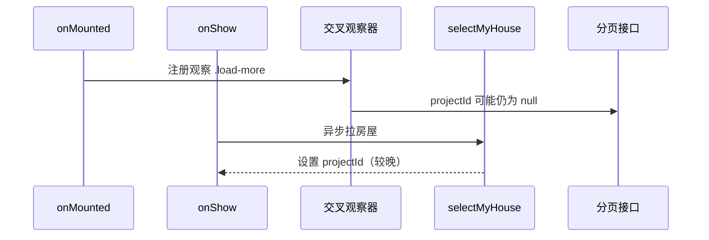

## 会话 03eda42a-989a-414d-9b8a-46649f591538
- 时间：2026-07-13T09:25:38　来源：cursor　模型：cursor-agent
- 代码基线：94c9140
- 用户轮次：5　工具调用：115
- 涉及文件：d:\repository\昆山市民\package.json、d:\repository\昆山市民、d:\repository\昆山市民\vite.config.js、d:\repository\昆山市民\src\main.js、d:\repository\昆山市民\src\request\index.js、d:\repository\昆山市民\src\env\mp.js、d:\repository\昆山市民\src、d:\repository\昆山市民\src\manifest.json

### 用户诉求 1
@package.json 补充H5脚本，本项目要做H5兼容改造。将来作为H5嵌入一个微信小程序。同时也要保留微信小程序的功能。先看看代码里面有哪些地方需要修改，先改了

### 用户诉求 2
useFaceVerify.js目前应该没有使用，删除相关的逻辑

### 用户诉求 3
[Image]

The following images were provided by the user and saved to the workspace for future use:
1. C:\Users\Administrator\.cursor\projects\d-repository/assets/c__Users_Administrator_AppData_Roaming_Cursor_User_workspaceStorage_9d7a40e0439ca03eb8c94c4fe387c775_images_image-527ca56d-a893-4c2b-b261-c6b104c1ee1d.png

These images can be copied for use in other locations.

首页UI有问题，第二行图标文字遮挡住了，修复一下

### 用户诉求 4
上面的banner图被导航遮挡住了，也修复一下

### 用户诉求 5
[Vue warn]: Property "index" was accessed during render but is not defined on instance. 
 at 
at 
at 
at 
at 
at 
at 
at 
at 
at

### 最终结论
已修复。

`swiper-item` 的 `v-for` 写成了 `menu in swiperMenuList`，但 `:key` 用了未定义的 `index`。

已改为 `(menu, pageIndex) in swiperMenuList`，并用 `pageIndex` 作为 key。刷新后该警告会消失。

---

## 会话 ea82ec90-7cc1-4d38-b7d1-2394a7ad3f09
- 时间：2026-07-07T08:42:54　来源：cursor　模型：cursor-agent
- 代码基线：da7cc0f
- 用户轮次：6　工具调用：94
- 涉及文件：d:\repository\昆山市民、d:\repository\昆山市民\src\api\modules\estate.js、d:\repository\昆山市民\src\pages_onlineService\onlineIndex.vue、d:\repository\昆山市民\src\pages\common\useEidVerify.js、d:\repository\昆山市民\API接口文档.md、d:\repository\昆山市民\src\pages\verifyUser\index.vue、d:\repository\昆山市民\src\pages\verifyUser\info.vue、d:\repository\昆山市民\src\env\mp.js

### 用户诉求 1
1、E证通-获取核身Token

接口 POST /weChatOauth/eid/getToken

{

“idCard“: 身份证号 ,

“name“: 姓名,

“config“: {

“inputType“： 姓名身份证输入方式：3-用户手动输入；

“useIntentionVerify“: 是否使用意愿核身功能 true ,

“intentionMode“: 意愿核身模式：3-点头确认模式

}

}

返回值：

{

  “eidToken“: E证通流程的唯一标识，有效时间600秒,

   “url“: 发起核身流程的URL，用于H5场景核身，有效期10分钟且仅能使用一次 ,

  “requestId“: 唯一请求ID

}

2、人脸识别 原来接口 POST： /weChatOauth/faceRecognition

将参数 key 传参换为 新接口返回的 eidToken 值

### 用户诉求 2
[Image]

The following images were provided by the user and saved to the workspace for future use:
1. C:\Users\Administrator\.cursor\projects\d-repository/assets/c__Users_Administrator_AppData_Roaming_Cursor_User_workspaceStorage_9d7a40e0439ca03eb8c94c4fe387c775_images________17833894735770-728559c6-dbc6-4740-9f75-53ac6b130d86.png

These images can be copied for use in other locations.

config 配置理 只传  InputType: 3 这个参数其他不要

### 用户诉求 3
InputType应该传4

### 用户诉求 4
🚀 ~ 人脸核身失败 ~ err: {"msg": "操作成功", "code": 200, "data": {"openId": "oXOMZ7QT6-YmwpVKyVP-0MBnpt70", "userSource": null, "name": "田野", "faceRecognition": "0", "idNumber": "320682199603126771", "accessToken": null, "lastFaceTime": null}}
现在应该是成功了，但是逻辑处理有误，修改一下

### 用户诉求 5
[响应] http://unlimited.g.h5.admin.web.v1.wuguan.kunshan.suzhou.test.zhishusz.com/prod-api/estate/weChatOauth/faceRecognition {"msg":"操作成功","code":200,"data":{"openId":"oXOMZ7QT6-YmwpVKyVP-0MBnpt70","userSource":null,"name":"田野","faceRecognition":"0","idNumber":"320682199603126771","accessToken":null,"lastFaceTime":null}}这是接口响应日志，现在还是提示失败，实际成功的

### 用户诉求 6
还是显示失败

### 最终结论
已定位并修复。接口日志里已有 `code: 200` 的成功响应，但仍提示失败，很可能是 **axios 拦截器在 HTTP `status` 不是严格 `200` 时提前 reject**，而响应日志在此之前已经打印。

## 修复内容

### 1. `src/request/index.js` — 响应拦截器
- 兼容 `res.status` / `res.statusCode`，接受 2xx 状态码（不再只认 `200`）
- 自动解析字符串类型的 `res.data`
- 用 `Number()` 统一处理业务 `code`

### 2. `src/pages/common/useEidVerify.js` — 核身结果处理
- 以 `code === 200` 或 `msg === '操作成功'` 判断成功，不再依赖 `faceRecognition == 1`
- 从 E 证通返回后延迟 300ms 再调 `wx.login`，减少偶发失败
- 增加兜底：即使进入 `catch`，若响应体表示成功也会 `resolve`

## 请按以下步骤测试

1. **重新编译**：`npm run build`（或重启 `npm run dev`）
2. **微信开发者工具**：导入 `dist/build/mp-weixin`（开发模式则是 `dist/dev/mp-weixin`）
3. **清除缓存**：工具 → 清缓存 → 全部清除，然后重新编译

如果仍失败，请看控制台是否有 `[E证通] faceRecognition failed:` 日志，把完整内容发我，便于继续排查。

---

## 会话 437a9bbe-d421-4340-9d73-bb0fec2c1e0b
- 时间：2026-06-26T03:53:35　来源：cursor　模型：cursor-agent
- 代码基线：a1b8beb
- 用户轮次：3　工具调用：101
- 涉及文件：d:\repository\昆山市民\src\pages_benefit\benefit\index.vue、d:\repository\昆山市民\src\stores\user.js、d:\repository\昆山市民\src\pages_ownerCard\ownerCard\index.vue、d:\repository\昆山市民\src\hooks\useLoadMore.js、d:\repository\昆山市民\src\App.vue、d:\repository\昆山市民\src、d:\repository\昆山市民\src\pages\verifyUser\info.vue、d:\repository\昆山市民\src\api\index.js

### 用户诉求 1
[Image]
[Image]

The following images were provided by the user and saved to the workspace for future use:
1. C:\Users\Administrator\.cursor\projects\d-repository/assets/c__Users_Administrator_AppData_Roaming_Cursor_User_workspaceStorage_9d7a40e0439ca03eb8c94c4fe387c775_images_image-d5e17567-b066-4b2b-beaa-7a784179df3c.png
2. C:\Users\Administrator\.cursor\projects\d-repository/assets/c__Users_Administrator_AppData_Roaming_Cursor_User_workspaceStorage_9d7a40e0439ca03eb8c94c4fe387c775_images_image-7b38d309-06dc-4831-90d1-6ad727c72fc1.png

These images can be copied for use in other locations.

多名客户反应说公共收益公示看不到了，并且多说之前都是可以看到的，虽然接口没报错，但是有点奇怪，测试小区，但是显示的小区名称与实际的不一样

### 用户诉求 2
benefit/index.vue 和 ownerCard/index.vue 中使用了未定义的 userStore（应为 useUser），在无房屋时会直接报错。这种问题全局排查一下，所有文件都查一下

### 用户诉求 3
统一命名规范

### 最终结论
已将项目中所有 `userStore` 统一为 `useUser` 命名规范。

## 变更说明

**统一规范：** `const useUser = useUserStore()`，后续统一使用 `useUser.xxx`

**修改的文件（共 9 个）：**

| 文件 | 变更内容 |
|------|----------|
| `api/index.js` | `userStore` → `useUser` |
| `App.vue` | 各生命周期内的 `userStore` → `useUser` |
| `pages_home/home.vue` | 模块级变量重命名 |
| `pages_contract/list.vue` | 模块级变量重命名 |
| `pages_repair/repair/expenseList.vue` | 模块级变量重命名 |
| `pages_vote/vote/votedetail.vue` | 移除回调内重复声明，复用顶层 `useUser` |
| `pages_election/election/Participate.vue` | 同上 |
| `pages/verifyUser/info.vue` | 同上 |
| `pages_activity_vote/detail.vue` | 新增顶层 `useUser`，移除回调内重复声明 |

**额外优化：** 在已有顶层 `const useUser = useUserStore()` 的文件中，删除了回调里重复的 `const userStore = useUserStore()`，避免同一页面内两套命名并存。

全局检索确认：`src` 目录下已无 `userStore` 引用。

---

## 会话 1d9b7d53-d5cd-4b5c-87e0-c3804303cc41
- 时间：2026-07-29T13:31:21　来源：cursor　模型：cursor-agent
- 代码基线：c8c1c24
- 用户轮次：4　工具调用：67
- 涉及文件：d:\repository\昆山市民、d:\repository\昆山市民\src\pages.json、d:\repository\昆山市民\src\pages_vote、d:\repository\昆山市民\src\pages_vote\vote\votedetail.vue、d:\repository\昆山市民\src\pages_vote\vote\components\DetailTop.vue、d:\repository\昆山市民\src\stores\vote.js、d:\repository\昆山市民\src\api\modules\vote.js、d:\repository\昆山市民\src\pages_vote\vote\index.vue

### 用户诉求 1
[Image]

The following images were provided by the user and saved to the workspace for future use:
1. C:\Users\Administrator\.cursor\projects\d-repository/assets/c__Users_Administrator_AppData_Roaming_Cursor_User_workspaceStorage_9d7a40e0439ca03eb8c94c4fe387c775_images________17853312225518-e49123f3-f080-46e7-a7ae-076d46a53879.png

These images can be copied for use in other locations.

这个决策详情还是不行，不知道咋回事，决策结果是可以看的

### 用户诉求 2
会存在不调用getDecisionDetail 接口的情况吗

### 用户诉求 3
H5里面不需要微信登录吧

### 用户诉求 4
H5条件下如果decisionId存在就可以调用接口，外面判断过了每次登录都用最新的code，缓存最新的token吧？

### 最终结论
已按你的思路改好了。

**H5**：有 `decisionId` 就直接调 `loadVoteDetail`，不再走 `loginWithWxCode`。token 由首页入口用最新 `code` 换好并缓存，请求拦截器会自动带上 `Authorization`。

**微信小程序**：仍先 `loginWithWxCode()`，再加载详情。

```122:159:src/pages_vote/vote/votedetail.vue
async function loadVoteDetail(decisionId) {
  if (!decisionId) return
  // ...实名检查 + getVoteDetail + 授权检查
}

onLoad(async (options) => {
  let decisionId = options.decisionId || ...
  // #ifdef H5
  await loadVoteDetail(decisionId)
  // #endif
  // #ifdef MP-WEIXIN
  loginWithWxCode().then(async () => {
    await loadVoteDetail(decisionId)
  })
  // #endif
})
```

实名检查还保留着——`getDecisionDetail` 需要传 `idNumber`，未实名仍会提示去认证。若你希望 H5 未实名也先拉详情（只读），可以说一下我再改。

---

## 会话 2bb761a5-ff39-4d37-b335-f2fee7fe877b
- 时间：2026-08-04T07:21:49　来源：cursor　模型：cursor-agent
- 代码基线：38d1482
- 用户轮次：1　工具调用：74
- 涉及文件：d:\repository\昆山市民\src\pages.json、d:\repository\昆山市民\src\pages_benefit\balancePublicity\index.vue、d:\repository\昆山市民\src\pages\common\components\ZsNav.vue、C:\Users\Administrator\.cursor\projects\d-repository\assets\c__Users_Administrator_AppData_Roaming_Cursor_User_workspaceStorage_9d7a40e0439ca03eb8c94c4fe387c775_images________17858271458437-4f019642-8159-4c01-a859-a6a568be15eb.png、d:\repository\昆山市民\src\App.vue、d:\repository\昆山市民\src\pages_cost\elevatorPubEngCons\index.vue、d:\repository\昆山市民\src\manifest.json、d:\repository\昆山市民\src\pages_benefit\benefit\index.vue

### 用户诉求 1
[Image]

The following images were provided by the user and saved to the workspace for future use:
1. C:\Users\Administrator\.cursor\projects\d-repository/assets/c__Users_Administrator_AppData_Roaming_Cursor_User_workspaceStorage_9d7a40e0439ca03eb8c94c4fe387c775_images________17858271458437-4f019642-8159-4c01-a859-a6a568be15eb.png

These images can be copied for use in other locations.

顶部的这个tile可以去掉，他自带了tile了。所有页面去除导航栏

### 最终结论
已处理。微信环境自带标题栏，页面里又叠了一层 uni-app H5 导航，所以会出现双栏。

主要改动：

1. **`pages.json`**：全局关闭 H5 导航栏（`titleNView: false`），并去掉各页的 `navigationStyle: custom`
2. **移除自定义导航 `ZsNav`**：公共收益、我的房屋等页面不再渲染自定义顶栏
3. **清理布局**：去掉为自定义导航预留的 `margin-top` 等样式

刷新 H5 后应只保留微信自带的「经营性收支公示」标题栏。若本地有缓存，重新编译/强刷一次即可。

---

## 会话 2c38c33c-ca79-4a52-aad9-5b1eb44802bd
- 时间：2026-06-26T05:41:21　来源：cursor　模型：cursor-agent
- 代码基线：a1b8beb
- 用户轮次：4　工具调用：58
- 涉及文件：d:\repository\昆山市民\src\pages_benefit\benefit\index.vue、d:\repository\昆山市民\src、d:\repository\昆山市民\src\api\modules\myhouse.js、d:\repository\昆山市民\src\api、d:\repository\昆山市民\src\hooks\useLoadMore.js、d:\repository\昆山市民\src\api\modules\common.js、d:\repository\昆山市民\src\stores、d:\repository\昆山市民\src\request\index.js

### 用户诉求 1
@src/pages_benefit/benefit/index.vue 分析总结页面接口调用逻辑，接口地址，参数，

### 用户诉求 2
进入页面和切换小区均没有调用接口

### 用户诉求 3
现在好像会调用2次分页接口

### 用户诉求 4
没有调用接口的问题是何时出现的，还是一直存在，根因是什么

### 最终结论
根据 Git 历史，这个问题**不是某一天突然出现的单一 bug**，而是页面从开发至今逐步叠加的几类设计缺陷。按时间线说明如下。

---

## 时间线

| 时间 | 提交 | 状态 |
|------|------|------|
| **2024-09-07** | `dc138d6` 公共收益页面开发 | 列表接口**完全未对接**：`getList` 是空壳，Promise 不 resolve；`list` 用 8 条假数据占位 |
| **2024-09-18** | `a14d084` 公共收益对接 | 接入 `getPubQuarterlyDeclaration`，但 `onShow` **从未调用 `refresh()`** |
| **2024-09-24** | `2a6ba01` bug修复 | 补上 `projectId: useUser.project`（此前请求缺关键参数） |
| **2024-09 ~ 2026-06** | 中间多次小改 | 一直靠交叉观察器被动加载，**没有在 `projectId` 就绪后主动拉列表** |
| **2026-06-26 上午** | `6418fe7` bug1250 | 加 `syncProjectInfoFromHouseList` + `refresh()`，试图修「C 端无法展示」 |
| **2026-06-26 下午** | `a1b8beb`（本次修复） | 调整 `getList` 顺序、显式初始化、延迟注册观察器 |

---

## 根因分析（分阶段）

### 1. 最初（2024-09-07 ~ 09-17）：列表接口从未调用

`getList` 里接口被注释掉，且没有 `resolve`：

```javascript
async function getList() {
  return new Promise((resolve, reject) => {
    // getPubQuarterlyDeclaration(...)  // 全注释
  })
}
```

同时 `list.value = [{}, {}, ...]` 用假数据撑 UI。这是**开发占位**，不是运行时偶发问题。

---

### 2. 对接后（2024-09-18 ~ 2026-06-26 上午）：长期存在的设计缺陷

对接后列表加载**只依赖** `useLoadMore` 在 `onMounted` 注册的交叉观察器，没有在合适的时机主动 `refresh()`。



核心问题：

1. **时序竞态**：观察器常在 `selectMyHouse` 完成前就触发，`projectId` 未就绪 → 请求失败或无效 → `status` 变为 `no-more`，后续不再请求。
2. **`onShow` 只拉房屋，不拉列表**：`projectId` 设好后没有 `refresh()`，列表不会重试。
3. **`projectId` 补得晚**：`2a6ba01` 之前请求甚至不带 `projectId`。
4. **小区同步逻辑不完整**：旧代码仅在 `!useUser.houseId` 时设小区；已有缓存 `houseId` 时可能不同步 `projectId`。

切换小区时虽然调了 `refresh()`，但若首屏观察器已把 `status` 打成 `no-more`，或 `projectId` 一直不对，表现同样是「列表接口不工作」。

---

### 3. bug1250 修复（`6418fe7`）当天：修了展示逻辑，又引入新问题

当天上午的改动：

- 新增 `syncProjectInfoFromHouseList`，统一同步小区
- 在 `selectMyHouse` 成功后加 `refresh()`

方向正确，但仍有问题：

1. **`refresh()` 绑在 ` …[truncated]

---

