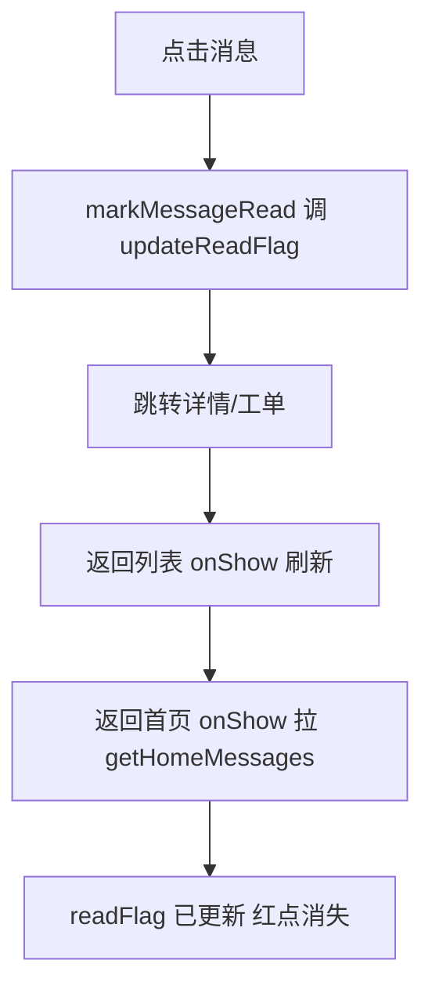

## 会话 53a1b5a9-a0bb-43b5-969a-34c78dd71d66
- 时间：2026-09-09T09:42:17　来源：cursor　模型：cursor-agent
- 代码基线：69959cd
- 用户轮次：2　工具调用：41
- 涉及文件：d:\repository\物业手持B端、d:\repository\物业手持B端\src\pages\complex-select\index.vue、d:\repository\物业手持B端\src\pages\home\index.vue、d:\repository\物业手持B端\src、d:\repository\物业手持B端\src\components\ZsPicker\ZsPicker.vue、d:\repository\物业手持B端\src\store\user.js、d:\repository\物业手持B端\src\pages\organization\index.vue、d:\repository\物业手持B端\src\pages\login\index.vue

### 用户诉求 1
首页切换小区行政区域不显示，接口有数据

### 用户诉求 2
修复首页切换小区行政区域不显示

Implement the plan as specified, it is attached for your reference. Do NOT edit the plan file itself.

To-do's from the plan have already been created. Do not create them again. Mark them as in_progress as you work, starting with the first one. Don't stop until you have completed all the to-dos.

### 最终结论
修复已完成。

## 修改说明

在 [`src/pages/complex-select/index.vue`](src/pages/complex-select/index.vue) 中增加了部门树节点字段归一化，兼容接口返回的 `deptName`/`deptId` 与原有的 `label`/`id`：

```118:142:src/pages/complex-select/index.vue
const getDeptNodeId = (item) => item?.id ?? item?.deptId ?? ''
const getDeptNodeLabel = (item) => item?.label ?? item?.deptName ?? item?.name ?? ''

const toPickerItems = (list) => {
  return (list || []).map((item) => ({
    text: getDeptNodeLabel(item),
    value: String(getDeptNodeId(item)),
  })).filter((item) => item.text && item.value)
}
// ...
const findDepartment = (list, deptId) => {
  for (const item of list || []) {
    if (String(getDeptNodeId(item)) === String(deptId)) return item
    // ...
  }
}
```

## 原因

`/system/dept/treeInPermission` 返回的是 `deptName`/`deptId`，原逻辑只读 `label`/`id`，导致选项被过滤为空，三个筛选器一直显示占位符。

## 验证

已用 `deptName`/`deptId` 模拟数据验证：区域 → 街道 → 社区三级级联可正常映射。

请在真机或 H5 上确认：
1. 首页点击「切换」后，区域筛选器可点击并有选项
2. 区域 → 街道 → 社区可逐级选择
3. 选择后小区列表能正确过滤

---

## 会话 05daaa96-3842-4bb4-9e0a-d1a9a0fc93a1
- 时间：2026-09-09T09:40:37　来源：cursor　模型：cursor-agent
- 代码基线：69959cd
- 用户轮次：2　工具调用：37
- 涉及文件：d:\repository\物业手持B端、d:\repository\物业手持B端\src\components\ZsDatePicker\ZsDatePicker.vue、d:\repository\物业手持B端\src\pages_facility\record\index.vue、d:\repository\物业手持B端\src\components\ZsPicker\ZsPicker.vue、d:\repository\物业手持B端\src、d:\repository\物业手持B端\src\components\ZsDialog\ZsDialog.vue、d:\repository\物业手持B端\src\pages_facility\components\FilterPopup.vue、d:\repository\物业手持B端\src\styles\filter.scss

### 用户诉求 1
工作台-巡检记录，筛选条件日期类的悬浮显示不对，巡检/维保/年检/报废 存在一样的问题，帮忙一起修复，改为年月日三级pick，不要用日历组件

### 用户诉求 2
工作台记录日期筛选 — 年月日三级 Picker 修复

Implement the plan as specified, it is attached for your reference. Do NOT edit the plan file itself.

To-do's from the plan have already been created. Do not create them again. Mark them as in_progress as you work, starting with the first one. Don't stop until you have completed all the to-dos.

### 最终结论
已完成修复，变更如下：

## 修改内容

### 1. 重构 [`src/components/ZsDatePicker/ZsDatePicker.vue`](src/components/ZsDatePicker/ZsDatePicker.vue)

- 移除原生 `<picker mode="date">`，避免与顶部筛选弹层（`ZsDialog`）嵌套冲突
- 改为点击开始/结束日期 → 底部 `uni-popup` + `picker-view` 三列（年 / 月 / 日）
- 保持原有 API：`v-model:start`、`v-model:end`、`type="range"`、placeholder
- 输出格式仍为 `YYYY-MM-DD`，与接口字段一致
- 范围约束：开始日期 ≤ 结束日期；年/月/日列随边界动态联动（含闰年、2 月等）

### 2. 清理 [`src/pages_facility/record/index.vue`](src/pages_facility/record/index.vue)

- 删除已无用的 `uni-datetime-picker` / `uni-calendar` 深度样式

## 影响范围

| 页面 | 效果 |
|------|------|
| 巡检 / 维保 / 年检 / 报废记录 | 共用 `record/index.vue`，一次修复全部生效 |
| 消息通知筛选 | 同样使用 `ZsDatePicker`，一并修复 |

页面层无需改动，API 传参（`inspectStartDate` / `scrappedStartDate` 等）保持不变。

## 建议验证

1. 工作台 → 任一类记录 → 「筛选」→ 点击开始/结束日期，确认底部弹出年月日三列 picker
2. 选择日期后格式为 `YYYY-MM-DD`，筛选结果正确
3. 先选结束日期再选开始日期，确认不能超出范围
4. 重置筛选后日期清空

---

## 会话 ce335c8e-5171-4165-8ef8-38b280007b21
- 时间：2026-09-09T09:49:51　来源：cursor　模型：cursor-agent
- 代码基线：69959cd
- 用户轮次：2　工具调用：36
- 涉及文件：d:\repository\物业手持B端\src\pages_facility\record\add.vue、d:\repository\物业手持B端\src\components\ZsUploader\ZsUploader.vue、d:\repository\物业手持B端\src\components\ZsDialog\ZsDialog.vue、d:\repository\物业手持B端\src\pages_facility\issue\components\TransferKnowledgeDialog.vue、d:\repository\物业手持B端\src\pages_facility\issue\components\CompleteDialog.vue、d:\repository\物业手持B端\package.json、d:\repository\物业手持B端\src\pages\workbench\index.vue、d:\repository\物业手持B端\src\pages_facility\record\index.vue

### 用户诉求 1
工作台-巡检记录，添加步骤后删除步骤，再次新增会自动带出上次的图片

### 用户诉求 2
修复巡检记录步骤删除后图片残留

Implement the plan as specified, it is attached for your reference. Do NOT edit the plan file itself.

To-do's from the plan have already been created. Do not create them again. Mark them as in_progress as you work, starting with the first one. Don't stop until you have completed all the to-dos.

### 最终结论
已按计划完成修复，改动仅在 [`src/pages_facility/record/add.vue`](src/pages_facility/record/add.vue)。

### 修改内容

1. **`ZsUploader` 加 `v-if`**：弹窗关闭时销毁上传组件，再次打开时重新挂载，避免 `uni-file-picker` 内部 `files` 残留。

```146:146:src/pages_facility/record/add.vue
            <ZsUploader v-if="showStepFormPopup" v-model="stepFormImages" :limit="9" :max="5" iconType="default" />
```

2. **统一取消逻辑**：新增 `onCancelStepForm`，关闭弹窗并调用 `resetStepForm()`。

```304:307:src/pages_facility/record/add.vue
const onCancelStepForm = () => {
  showStepFormPopup.value = false
  resetStepForm()
}
```

### 逻辑验证

| 场景 | 预期行为 |
|------|----------|
| 新增 → 保存 → 编辑 → 删除 → 再新增 | 图片区域为空 |
| 编辑含图步骤 | 图片正常回填 |
| 新增上传后取消 → 再新增 | 图片区域为空 |
| 保存步骤 A 后新增步骤 B | B 的图片区域为空 |

维保、年检记录共用该页面，会一并生效。建议在 H5 或小程序上按上表走一遍主路径确认。

---

## 会话 747e8de3-8451-445c-b38e-96d5b6f219fc
- 时间：2026-09-09T09:37:46　来源：cursor　模型：cursor-agent
- 代码基线：69959cd
- 用户轮次：1　工具调用：37
- 涉及文件：d:\repository\物业手持B端、d:\repository\物业手持B端\src\pages.json、d:\repository\物业手持B端\src\pages\home\index.vue、d:\repository\物业手持B端\src\pages\cashier\result.vue、d:\repository\物业手持B端\src\pages\cashier\index.vue、d:\repository\物业手持B端\src\pages\cashier\bill-detail.vue、d:\repository\物业手持B端\src\components\ZsPopup\ZsPopup.vue、d:\repository\物业手持B端\src\pages\cashier\payment.vue

### 用户诉求 1
在仓库 d:\repository\物业手持B端 中搜索与「首页收银台」「查看收款明细」「收款明细」相关的代码。

请查找：
1. 相关页面/组件文件路径
2. 路由配置
3. 样式文件
4. 可能导致 UI 紊乱的布局/CSS 问题线索

返回：关键文件列表、组件结构简述、任何明显的布局问题（如 flex/grid 冲突、缺少样式、条件渲染问题等）。

### 最终结论
## 搜索结果概览

仓库中**没有**精确匹配「查看收款明细」的文案；实际使用的是：
- 底部栏：**「查看明细 >」**（`result.vue` 第 167 行）
- 弹窗标题：**「收款明细」**（`result.vue` 第 190 行）

---

## 1. 关键文件列表

### 页面 / 组件

| 路径 | 说明 |
|------|------|
| `d:\repository\物业手持B端\src\pages\home\index.vue` | 首页「常用功能」收银台入口 |
| `d:\repository\物业手持B端\src\pages\workbench\index.vue` | 工作台收银台入口（逻辑同首页） |
| `d:\repository\物业手持B端\src\pages\cashier\index.vue` | 收银台首页：房屋信息查询表单 |
| `d:\repository\物业手持B端\src\pages\cashier\result.vue` | **核心页**：账单缴费 / 缴费记录、底部收款栏、「收款明细」弹窗、支付方式弹窗 |
| `d:\repository\物业手持B端\src\pages\cashier\payment.vue` | 扫码支付页 |
| `d:\repository\物业手持B端\src\pages\cashier\bill-detail.vue` | 缴费记录中的「账单明细」子页 |
| `d:\repository\物业手持B端\src\pages\cashier\session.js` | 房屋信息 / Tab 状态缓存 |

### 依赖组件

| 路径 | 用途 |
|------|------|
| `d:\repository\物业手持B端\src\components\ZsNav\ZsNav.vue` | 顶部导航 |
| `d:\repository\物业手持B端\src\components\ZsTab\ZsTab.vue` | 账单缴费 / 缴费记录 Tab |
| `d:\repository\物业手持B端\src\components\ZsPopup\ZsPopup.vue` | 收款明细 / 支付方式底部弹窗 |
| `d:\repository\物业手持B端\src\components\ZsDict\ZsDict.vue` | 支付状态字典展示 |
| `d:\repository\物业手持B端\src\components\ZsWatermark\ZsWatermark.vue` | 水印 |

### API

| 路径 | 说明 |
|------|------|
| `d:\repository\物业手持B端\src\api\cashier.js` | 账单、订单、支付渠道、下单等接口 |
| `d:\repository\物业手持B端\src\api\property.js` | `getCashierHouseInfo` 房屋查询 |

---

## 2. 路由配置

`d:\repository\物业手持B端\src\pages.json`：

```41:68:d:\repository\物业手持B端\src\pages.json
    {
      "path": "pages/cashier/index",
      "style": {
        "navigationStyle": "custom",
        "disableScroll": true
      }
    },
    {
      "path": "pages/cashier/result",
      "style": {
        "navigationStyle": "custom",
        "enablePullDownRefresh": true,
        "backgroundTextStyle": "dark"
      }
    },
    {
      "path": "pages/cashier/payment",
      "style": {
        "navigationStyle": "custom",
        "disableScroll": true
      }
    },
    {
      "path": "pages/cashier/bill-detail",
      "style": {
        "navigationStyle": "custom",
        "enable …[truncated]

---

## 会话 31e56e87-f93b-4afc-9f0f-2dcce53399f5
- 时间：2026-09-09T09:56:15　来源：cursor　模型：cursor-agent
- 代码基线：69959cd
- 用户轮次：1　工具调用：37
- 涉及文件：d:\repository\物业手持B端、d:\repository\物业手持B端\src、d:\repository\物业手持B端\src\pages\workbench\index.vue、d:\repository\物业手持B端\src\pages_facility\issue\index.vue、d:\repository\物业手持B端\src\pages_facility\record\index.vue、d:\repository\物业手持B端\src\pages\announcement\index.vue、d:\repository\物业手持B端\src\pages\organization\index.vue、d:\repository\物业手持B端\src\components\ZsTab\ZsTab.vue

### 用户诉求 1
在仓库 d:\repository\物业手持B端 中查找其他工作台列表页作为 UI 参考，特别是：
1. 带有分块 tab 的列表页
2. 灰色页面背景 + 白色列表项卡片的样式模式

搜索工作台相关页面、tab 组件使用、列表页样式（如 page背景 #f5f5f5 或类似、item 白色背景）。

返回：2-3 个最佳参考页面的文件路径、tab 实现方式、关键样式类名/变量。

### 最终结论
## 搜索结果：工作台相关列表页 UI 参考

工作台入口在 `d:\repository\物业手持B端\src\pages\workbench\index.vue`，其跳转的子页面里，以下 3 个最符合「分块 Tab + 灰底白卡列表」模式。

---

### 1. 报修/报事工单列表（首选）

**路径：** `d:\repository\物业手持B端\src\pages_facility\issue\index.vue`  
**入口：** 工作台 → 报修工单 / 报事工单

**Tab 实现：** 页面内自定义横向滚动 Tab（非第三方组件）

```3:16:d:\repository\物业手持B端\src\pages_facility\issue\index.vue
    <div class="tab-box">
      <scroll-view scroll-x :show-scrollbar="false" class="tab-scroll">
        <div class="tab-list">
          <div
            v-for="(item, index) in visibleTabOptions"
            :key="index"
            class="tab-item"
            :class="{ active: activeTab === item.value }"
            @tap="onTabChange(item.value)"
          >
            {{ item.label }}
          </div>
        </div>
      </scroll-view>
    </div>
```

- 状态：`activeTab` + `visibleTabOptions`（全部/待受理/待处理/处理中/已关闭/已退回）
- Tab 栏：白底 `.tab-box { background: #FFFFFF }`
- 激活态：蓝色文字 `#0168F0` + 底部短横线 `::after`（宽 30rpx、高 6rpx）

**灰底 + 白卡样式：**

| 区域 | 类名 | 关键样式 |
|------|------|----------|
| 页面背景 | `:deep(uni-page-body)` | `background: #f7f7f7` |
| Tab 栏 | `.tab-box` | `background: #FFFFFF` |
| 列表容器 | `.list-box` | `padding: 24rpx` |
| 列表卡片 | `.card` | `background: #FFFFFF; border-radius: 16rpx` |
| 卡片间距 | `.list-item + .list-item` | `margin-top: 24rpx` |

---

### 2. 收银台结果页（复用 Tab 组件）

**路径：** `d:\repository\物业手持B端\src\pages\cashier\result.vue`  
**入口：** 工作台 → 收银台

**Tab 实现：** 使用公共组件 `ZsTab`

```36:43:d:\repository\物业手持B端\src\pages\cashier\result.vue
      <view class="tab-bar">
        <ZsTab
          :model-value="activeTab"
          :list="tabList"
          underline
          @change="handleTabChange"
        />
      </view>
```

- 组件路径：`d:\repository\物业手持B端\src\components\ZsTab\ZsTab.vue`
- 样式来源：`d:\repository\物业手持B端\src\styles\tab.scss`
- 支持：`underline`（底部指示条）、`justify`（左对齐）、`v-model` 双向绑定
- 全局变量：`var(--primary-color)`、`var(--white-color)`（定义于 `src/styles/index.css`）

**灰底 + 白卡样式：**

| 区域 | 类名 | 关键样式 |
|------|------|------ …[truncated]

---

## 会话 a15deb31-e978-46bc-a0d9-a8b7c5050469
- 时间：2026-09-09T09:38:00　来源：cursor　模型：cursor-agent
- 代码基线：69959cd
- 用户轮次：2　工具调用：29
- 涉及文件：d:\repository\物业手持B端\src\pages\home\index.vue、d:\repository\物业手持B端\src\pages\message\index.vue、d:\repository\物业手持B端\src\pages\message\detail.vue、d:\repository\物业手持B端\src\api\msg.js、d:\repository\物业手持B端\src、d:\repository\物业手持B端\src\api、d:\repository\物业手持B端\src\api\home.js、d:\repository\物业手持B端\package.json

### 用户诉求 1
首页消息通知，点击查看详情后返回依然有未读红点

### 用户诉求 2
修复首页消息通知查看详情后未读红点不消失

Implement the plan as specified, it is attached for your reference. Do NOT edit the plan file itself.

To-do's from the plan have already been created. Do not create them again. Mark them as in_progress as you work, starting with the first one. Don't stop until you have completed all the to-dos.

### 最终结论
已按计划完成修复，改动如下。

## 修改内容

### 1. [`src/pages/message/index.vue`](src/pages/message/index.vue)

- 新增 `markMessageRead`：未读且有 `msgRangeId` 时调用 `updateReadFlag`，成功后本地 `item.unread = false`；失败不阻断跳转。
- `openMessage` 改为 `async`，跳转详情或工单页前先执行 `markMessageRead`。
- `onShow` 调整：字典只在首次加载；**每次**进入页面都会 `loadMessages({ reset: true })`，从详情返回会刷新列表。

### 2. [`src/pages/home/index.vue`](src/pages/home/index.vue)

- `applyMessages` 未读判断由 `readFlag !== '1'` 改为 `readFlag === '0'`，与消息列表一致。

## 修复逻辑



## 建议验证

1. 找一条未读消息 → 首页 → 消息列表 → 点击进入详情  
2. 返回列表：该条图标红点应消失  
3. 返回首页：通知区域红点应消失  
4. 工单类消息点击后，返回列表/首页红点同样应消失  

请在真机或 H5 上走一遍上述路径确认效果。

---

